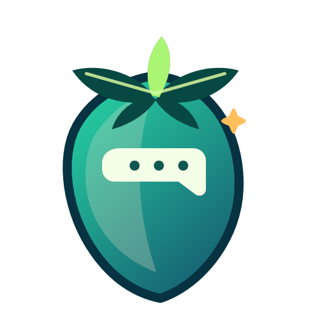

# Caper

Caper is a local, single-user agentic chat workspace for multi-agent
conversations, branching threads, automation, projects, and sandboxes.

There is one user and no login or accounts. The server binds `0.0.0.0` but only
answers loopback connections; any other peer is disconnected, so the workspace
is reachable from this machine only.

The application is built with Rust across one process: a WebAssembly frontend,
a Rust development server, and an embedded agent harness.

## Highlights

- Multi-session chat with tabs and branching conversation history
- Multiple agents with shared or session-specific participants
- Streaming model responses and tool activity
- OpenAI-compatible providers plus local OpenCode CLI models
- Projects, worktrees, sandboxes, and automations
- A component-driven UI and `/storybook` design guide
- Windows and Unix development scripts

## Favicon



Transparent Caper berry chat mark. Source `ui/assets/favicon-source.png`; generated `favicon.ico`, `favicon-16.png`, `favicon-32.png`, `favicon.png`, and `apple-touch-icon.png` with `ui/assets/generate-favicon.ps1`. Wired in `ui/index.html`.

## Stack

| Layer | Technology |
|---|---|
| Frontend | Rust, WebAssembly, rustex1 |
| Backend | Rust, rustex1 dev server |
| Agent harness | Vendored `angela-rs` |
| Model layer | Vendored `agl-rs` |
| Persistence | SQLite under `.caper/` |

## Run

```bash
./dev.sh
```

On Windows:

```powershell
.\dev.ps1
```

Open <http://127.0.0.1:3030>.

Optional port override:

```bash
./dev.sh 4000
.\dev.ps1 4000
```

Use `--rebuild` to force a fresh frontend build.

## Models

Provider and model configuration lives in `~/.config/agl/config.yaml`.
OpenAI-compatible endpoints can be declared under `endpoints`.

An installed `opencode` CLI is detected automatically. Caper adds discovered
free models as `opencode:<model-id>` entries and runs turns through the CLI.
OpenCode therefore uses its own provider configuration and tool loop.

## Layout

```text
app/       Rust -> WebAssembly frontend
server/    Rust server and /api/* handlers
crates/    shared application contracts
ui/        document shell and shared styles
docs/      design and implementation notes
archive/   frozen reference material
vendor/    rustex1, angela-rs, and agl-rs
```

Conversation data is stored locally in `.caper/conversations.db`. Existing
`.angela/` projects are migrated automatically when Caper starts.

## Development

```bash
cargo build -p caper-server
cargo test --manifest-path vendor/agl-rs/Cargo.toml opencode
```

The frontend and design guide follow the component rules in `AGENTS.md`.
*** End Patch
